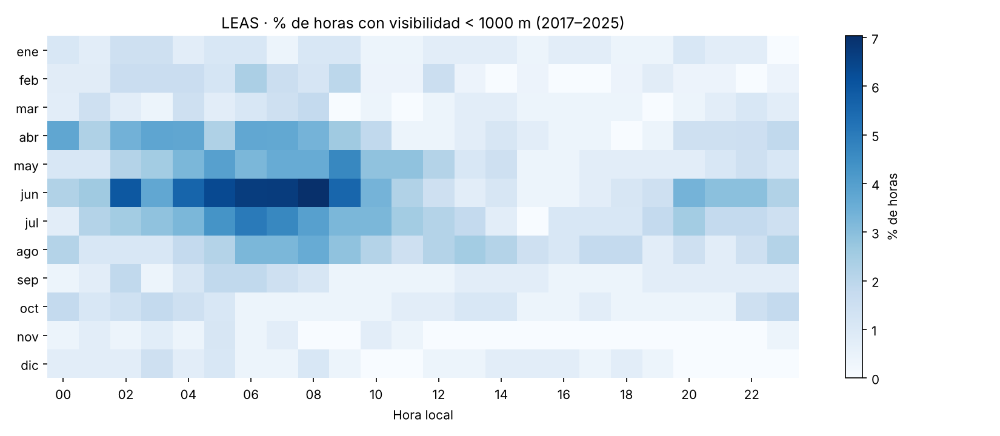
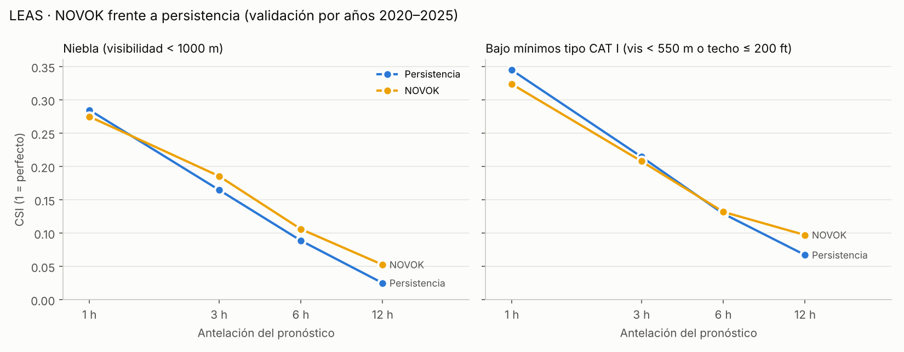
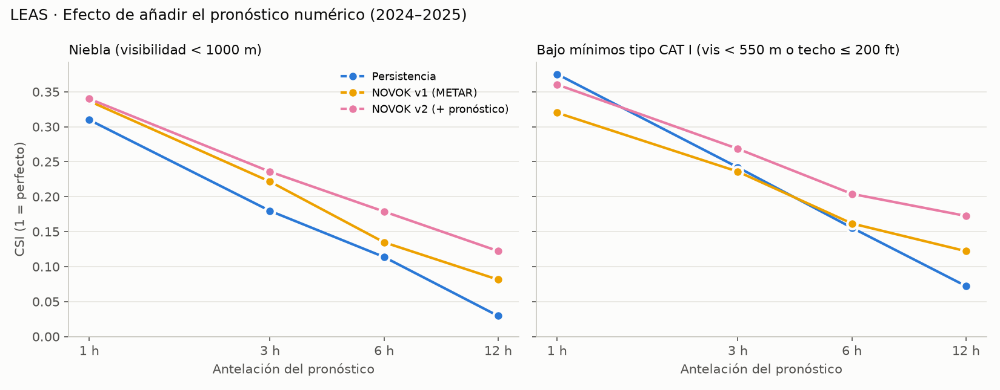
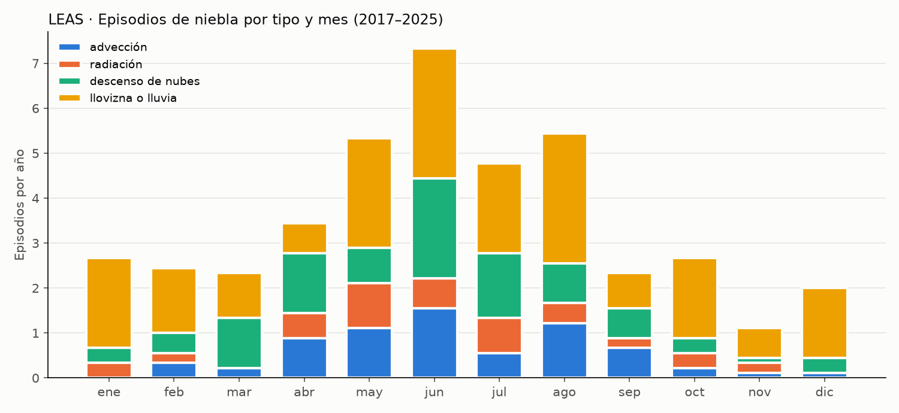
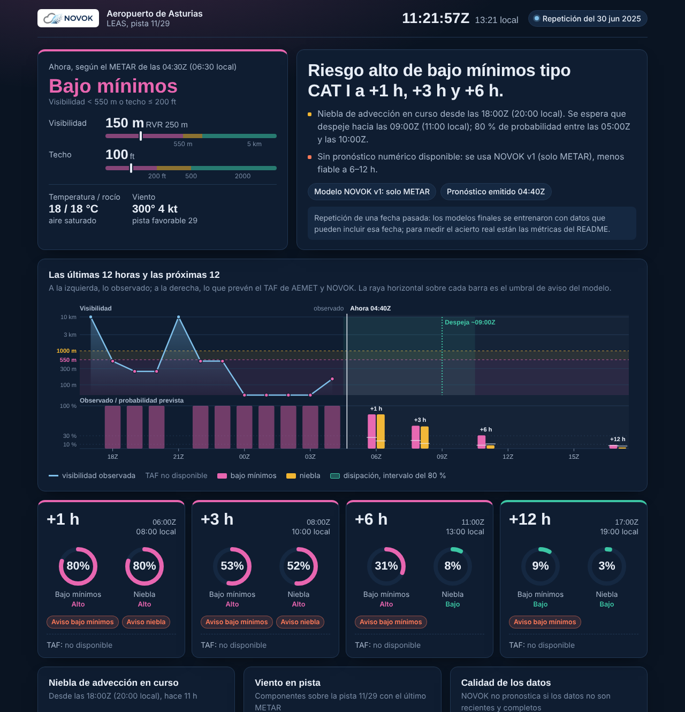

<p align="center">
  
</p>

<p align="center"><em>Will it be CAVOK? NOVOK tells you when it won't.</em></p>

# NOVOK

**NOwcasting Of Visibility & Overcast Kit** — predicción de niebla y techo de nubes con IA
para los aeropuertos del norte de España. Empezó en el Aeropuerto de Asturias (LEAS) y desde F6 cubre toda la red.

El nombre juega con **CAVOK** (*Ceiling And Visibility OK*), el código aeronáutico de
«techo y visibilidad bien». NOVOK predice justo lo contrario: cuándo **no** lo estarán.

Modelo de IA que predice, hora a hora, la probabilidad de niebla y techo de nubes bajo
en el Aeropuerto de Asturias, y se compara de forma honesta con el pronóstico oficial (TAF).

**Lo que busca hacer que el TAF no hace:** probabilidad por hora y por umbral operativo,
actualización con cada METAR, hora estimada de disipación, explicación del porqué
y un marcador público contra el TAF.

> ⚠️ **Herramienta de apoyo a la planificación de operaciones** (personal, autobuses, hoteles, tripulaciones,
> rotaciones). **No sustituye a la información meteorológica aeronáutica oficial**: en la UE solo la pueden
> proporcionar proveedores certificados (Reglamento (UE) 2017/373), en España AEMET, y es la que vale para las
> decisiones de vuelo. NOVOK no emite METAR ni TAF: traduce la previsión en impacto operativo.

**Mapa de la red en directo:** https://gelan03.github.io/novok/

## Estado

| Fase | Descripción | Estado |
|---|---|---|
| F0 | Repositorio, estructura, CI | ✅ |
| F1 | Datos: METAR histórico, limpieza y análisis exploratorio | ✅ |
| F2 | Baselines (persistencia, climatología, TAF) | 🔄 persistencia y climatología ✅ · TAF grabándose en directo |
| F3 | Modelo: niebla + techo de nubes | ✅ v1 (METAR) y v2 (METAR + pronóstico numérico) |
| F4 | Hora de disipación y tipo de niebla | ✅ |
| F5 | Briefing web en directo (niebla, techo, disipación, viento en pista, comparación con el TAF) | ✅ |
| F6 | Red del norte: 13 aeropuertos, mapa 2D de la red y briefing por aeropuerto | ✅ |
| F7 | Vuelos en el aire con riesgo a su llegada y alternativo; mapa con relieve y ortofoto en 3D | ✅ |
| F7b | Histórico de desvíos reales para validar el riesgo por vuelo | ⏳ |
| F8 | Verificación independiente (temporada 2026 no usada) frente al TAF, y valor económico por llegada | ✅ código · 🔄 ejecutar con datos de 2026 |
| F9 | Piloto: alertas configurables y API para el centro de operaciones de un cliente | ⏳ |

## Primeros resultados (METAR 2017–2025)



| Indicador (media anual) | Valor |
|---|---|
| Días con alguna hora de visibilidad < 1000 m | ~36 |
| Días por debajo de mínimos tipo CAT I (vis < 550 m o techo ≤ 200 ft) | ~58 |
| Horas con visibilidad < 1000 m | ~116 (1,3 % del año) |
| Horas con techo ≤ 200 ft | ~235 |
| Episodios de niebla | ~46, duración mediana 2 h |
| Días con viento cruzado (con racha) > 20 kt | ~28 |

- **Es niebla de advección marina, no de radiación:** pico de abril a agosto (máximo en junio, de 02 a 09 h),
  con viento del NW/W desde el mar en el 60 % de los casos.
- **El techo bajo pesa más que la visibilidad:** hay el doble de horas con techo ≤ 200 ft que con visibilidad < 550 m.
- Antes de 2017 no hay METAR de madrugada (00–06 h), justo cuando más niebla hay; esos años se excluyen de la estadística.

## Baselines (F2)

Antes de entrenar nada hay que saber qué hay que batir. Para cada hora y antelación L,
el pronóstico se "emite" L horas antes y **solo usa lo que se sabía en ese momento**:

| Método | Qué predice |
|---|---|
| Persistencia | Lo observado en la última hora completa antes de emitir |
| Climatología | Frecuencia del suceso para ese mes y hora local, sin contar el propio año |
| TAF | El último TAF/enmienda emitido como muy tarde L h antes: condición predominante, peor caso (con TEMPO/PROB) y probabilidad |

Todos se comparan en la misma muestra de horas, contra la peor visibilidad/techo observados en cada hora.

**Persistencia (2017–2025), CSI:**

| Antelación | Niebla (< 1000 m) | Bajo mínimos tipo CAT I |
|---|---|---|
| 1 h | 0,26 | 0,34 |
| 3 h | 0,15 | 0,21 |
| 6 h | 0,08 | 0,12 |
| 12 h | 0,03 | 0,07 |

La niebla de LEAS es breve (episodios de ~2 h): mirar la hora anterior deja de servir enseguida.

**Fuente de TAF:** el histórico de Ogimet no devuelve datos, así que los TAF se graban en directo desde
[aviationweather.gov](https://aviationweather.gov/data/api/) cada 30 min con GitHub Actions
(`.github/workflows/grabar_taf.yml` → `data/vivo/taf_LEAS.txt`). La comparación con el TAF crece con cada día grabado.

**Conversión del TAF a probabilidad** (el TAF no da un número para todos los grupos; convención propia):
predominante bajo umbral = 1; PROB30 = 0,3; PROB40 = 0,4; TEMPO y transición BECMG = 0,5.

## Modelo NOVOK v1 (F3)

LightGBM por suceso y antelación, entrenado **solo con METAR**: estado actual, tendencias de 1–3 h,
historial reciente de niebla y calendario. Validación por años con ventana creciente: para evaluar el
año Y se entrena con los años anteriores y el umbral de decisión se elige en Y−1. Nunca ve el año evaluado.



**Niebla (< 1000 m), 2020–2025, mismas horas para todos:**

| Antelación | CSI NOVOK | CSI persistencia | Brier skill NOVOK | Brier skill persistencia |
|---|---|---|---|---|
| 1 h | 0,28 | 0,29 | +0,26 | −0,13 |
| 3 h | 0,19 | 0,17 | +0,14 | −0,46 |
| 6 h | 0,11 | 0,09 | +0,06 | −0,71 |
| 12 h | 0,05 | 0,03 | +0,01 | −0,94 |

(Brier skill respecto a la climatología: > 0 mejora, < 0 empeora.)

**Lectura honesta:**
- Como **probabilidad**, NOVOK es claramente mejor que la persistencia y está bien calibrado
  ([fiabilidad](reports/modelo_fiabilidad.png)).
- Como **decisión sí/no**, a 1 h empata con la persistencia y a 3–12 h gana por poco. El umbral elegido en un
  solo año de validación es inestable (0,08–0,30).
- **El techo de lo que se puede hacer solo con METAR:** a 6–12 h el modelo depende sobre todo de la época del
  año. Para anticipar la niebla con horas de antelación hacen falta pronósticos numéricos (viento y humedad
  previstos, temperatura del mar). Es el siguiente paso.
- Lo que más pesa ([importancia SHAP](reports/modelo_importancia.png)): humedad, temperatura, época del año y la
  componente oeste del viento — el aire que llega del mar, coherente con la niebla de advección.

## NOVOK v2: + pronóstico numérico (F3)

Se añaden pronósticos de modelos meteorológicos (ECMWF IFS desde 2024, JMA GSM desde 2018) de la API
**Previous Runs** de Open-Meteo, usando **el pronóstico emitido ~24 h antes** de cada hora (`_previous_day1`).

¿Por qué no la API de pronósticos históricos? Encadena las primeras horas de cada pasada del modelo:
valores que se publicaron *después* del momento en que NOVOK habría emitido. Usarlos inflaría los
resultados artificialmente. El pronóstico de 24 h antes ya estaba publicado con 1–12 h de antelación.

Variables: humedad, diferencia temperatura–rocío, nubes bajas, visibilidad y viento previstos para la hora
objetivo; cambio previsto respecto a ahora; y error actual del modelo frente al METAR.

v1 y v2 se entrenan con las mismas filas y la misma validación por años; los resultados se separan para
2024–2025, los únicos años con ECMWF.



**CSI en 2024–2025 (mismas horas para todos):**

| Antelación | Niebla v1 | Niebla v2 | Persistencia | Bajo mínimos v1 | Bajo mínimos v2 | Persistencia |
|---|---|---|---|---|---|---|
| 1 h | 0,34 | 0,34 | 0,31 | 0,32 | 0,36 | 0,38 |
| 3 h | 0,22 | 0,24 | 0,18 | 0,24 | 0,27 | 0,24 |
| 6 h | 0,14 | **0,18** | 0,11 | 0,16 | **0,20** | 0,16 |
| 12 h | 0,08 | **0,12** | 0,03 | 0,12 | **0,17** | 0,07 |

- El pronóstico numérico aporta donde la v1 no llegaba: **+30–50 % de CSI a 6–12 h**, y la habilidad
  probabilística a 12 h pasa de +0,02 a +0,06 (niebla) y de +0,05 a +0,09 (bajo mínimos).
- A 1 h no cambia: manda lo que dice el METAR. En bajo mínimos a 1 h la persistencia sigue siendo
  ligeramente mejor.
- **¿Es real o suerte?** Remuestreo por días (2000 réplicas): a 6 y 12 h la mejora de v2 sobre v1 tiene un
  intervalo de confianza del 95 % que no incluye el cero, en niebla y en bajo mínimos. A 1–3 h en niebla
  la diferencia no es significativa.
- Variables disponibles en el archivo de pasadas anteriores: temperatura, rocío, humedad, viento, nubosidad
  total, presión y precipitación (no hay nubes bajas ni visibilidad).

## Tipos de niebla y disipación (F4)

**Tipos** (reglas físicas basadas en Tardif y Rasmussen, 2007; no hay etiquetas reales):



| Tipo | Episodios/año | Duración mediana | Duración p90 | Visibilidad mínima mediana |
|---|---|---|---|---|
| Llovizna o lluvia | 20 | 1 h | 4 h | 550 m |
| Descenso de nubes | 10 | 4 h | 8 h | 300 m |
| Advección | 7 | 2 h | 7 h | 250 m |
| Radiación | 5 | 2 h | 5 h | 200 m |

- Más de la mitad de los episodios llegan con **orbayu**: llovizna con niebla, breves.
- Los más largos son los de **estratos que bajan hasta el suelo**, típicos del verano cantábrico.
- La niebla de **radiación** (noches en calma) es la menos frecuente, pero la más cerrada.

**¿Cuándo se levanta?** Para cada hora con niebla, NOVOK predice las horas que faltan con un intervalo
del 80 % (regresión por cuantiles con LightGBM; variables: METAR actual, tendencias, altura del sol, tipo).
Validación por años 2020–2025, frente a la climatología condicionada (mismo tiempo transcurrido y época):

| | Error medio NOVOK | Error medio climatología | Intervalo 80 % NOVOK | Intervalo 80 % climatología |
|---|---|---|---|---|
| Todas las horas | 1,8 h | 2,0 h | 3,6 h de ancho | 4,7 h de ancho |
| Episodios de 3 h o más | 2,1 h | 2,5 h | 3,8 h de ancho | 4,8 h de ancho |

Las dos coberturas rondan el 80–85 %. La mejora es significativa (remuestreo por episodios: −0,24 h de error
en general y −0,42 h en episodios largos, IC 95 % sin cero), aunque modesta: en episodios de 1–2 h es difícil
batir a «se levanta en la próxima hora».

## Briefing en directo (F5)



*Repetición del 30 de junio de 2025, 04:40Z: niebla de advección en curso; NOVOK estimó que despejaría hacia las
09:00Z (80 %: 05:00–10:00Z). Despejó a las 10:00Z.*

**Arquitectura sin servidor:** cada 30 min, GitHub Actions descarga el METAR y el TAF de LEAS
(aviationweather.gov) y el pronóstico numérico (Open-Meteo), ejecuta los modelos guardados en `modelos/`
y publica `briefing.json` y la página en GitHub Pages.

```
METAR + TAF (NOAA) ─┐
                    ├─► novok.app.briefing ─► briefing.json ─► web/index.html (GitHub Pages)
NWP (Open-Meteo) ───┘        │
                       modelos/ (v2, v1, disipación, umbrales)
```

**Prácticas de software operativo (sin ser un sistema operativo):**
- **El mismo código en entrenamiento y en directo:** los METAR en texto se convierten al formato de
  entrenamiento y pasan por la misma limpieza. Validado contra 40 000 METAR reales: 100 % de coincidencia
  en viento, temperatura, rocío, QNH y altura de nubes.
- **Control de calidad:** sin pronóstico si el último METAR tiene más de 90 min o faltan más de 6 de las
  últimas 24 h.
- **Degradación controlada:** sin pronóstico numérico → NOVOK v1 (solo METAR), y lo dice.
- **Trazabilidad:** versión del modelo, hora de cada fuente, umbrales y METAR original en el propio briefing;
  el resumen en texto sale de reglas, no de un modelo de lenguaje, así que cada frase se puede rastrear.
- **Incertidumbre visible:** probabilidad, nivel (bajo < 10 %, moderado 10–30 %, alto ≥ 30 %), aviso cuando se
  supera el umbral del modelo e intervalo del 80 % para la disipación.
- **Comparación en directo con el TAF** de AEMET para las mismas horas.
- **Visor 3D del aeropuerto** (three.js) sobre el relieve real: dibuja la niebla observada o prevista y la mueve con
  el viento. Es una ilustración de la previsión, no una simulación física.

## Red del norte (F6)

NOVOK pasa de un aeropuerto a una red. Todo el código trabaja con un **aeropuerto activo**: sus datos van en
`data/processed/<OACI>/`, sus modelos en `modelos/<OACI>/` y sus pistas (rumbos y umbrales) salen de
[OurAirports](https://ourairports.com/data/), una base de datos abierta, guardada en `config/aeropuertos.json`.

| OACI | Aeropuerto | OACI | Aeropuerto | OACI | Aeropuerto |
|---|---|---|---|---|---|
| LEAS | Asturias | LEVT | Vitoria | LELN | León |
| LEXJ | Santander | LEPP | Pamplona | LEVD | Valladolid |
| LEBB | Bilbao | LELO | Logroño | LEST | Santiago |
| LESO | San Sebastián | LEBG | Burgos | LECO | A Coruña |
| | | | | LEVX | Vigo |

- **Un modelo por aeropuerto**, con el mismo método y la misma validación por años que LEAS. Cada aeropuerto
  tiene su clima: no se mezclan.
- **Control de cobertura:** algunos aeropuertos cierran de noche y no emiten METAR de madrugada, justo cuando
  más niebla hay. `python -m novok.red estado` lo muestra y el entrenamiento avisa.
- **Mapa de la red** (`web/index.html`): cada aeropuerto con su categoría de vuelo actual y la probabilidad máxima
  de bajo mínimos en 12 h; banda de aviso con los aeropuertos en riesgo alto; lista ordenada por riesgo.
- **Briefing por aeropuerto** (`web/aeropuerto.html?a=LEXJ`): el de F5, con el visor 3D y la rosa de vientos
  generados a partir de las pistas reales de cada aeropuerto.
- **Sin servicios de mapas externos:** el mapa base es propio (Natural Earth, dominio público) y el relieve del
  visor 3D se genera una vez por aeropuerto (`python -m novok.red terreno`) y se sirve desde el sitio. Librerías y
  fuentes también van alojadas en `web/vendor/`, con sus licencias abiertas (BSD, MIT, OFL, Apache) en
  `web/vendor/licencias/`, todas compatibles con el uso comercial.
- **El mejor modelo en cada caso:** en cada aeropuerto, suceso y antelación se usa v1 o v2 según cuál validó mejor
  en 2024-2025 (`modelos/<OACI>/eleccion.json`).
- **Horas en hora peninsular** en toda la web (los datos van en UTC por dentro).
- **Un solo proceso para todos:** cada 30 min, GitHub Actions genera los 13 briefings y `red.json`; si un aeropuerto
  falla, el resto se publica igual.

```
config/aeropuertos.json ─┐
METAR + TAF (NOAA) ──────┼─► novok.red briefing ─► datos/<OACI>.json + datos/red.json ─► index.html (mapa)
NWP (Open-Meteo) ────────┘        │                                                    └► aeropuerto.html
                           modelos/<OACI>/
```

## Vuelos en directo y cartografía (F7)

- **Vuelos en el aire** en el mapa de la red y en cada aeropuerto: posición, altitud, velocidad y ruta. Para cada
  vuelo que va a un aeropuerto de la red se calcula la **hora estimada de llegada**, la **probabilidad de bajo
  mínimos CAT I en el destino a esa hora** (interpolando la previsión de NOVOK) y un **alternativo orientativo**
  (el aeropuerto cercano con mejor previsión). Si no se conoce la ruta, un avión bajo, descendiendo y apuntando a
  un aeropuerto de la red se asigna a ese aeropuerto.
- **Fuente intercambiable** (`web/vuelos.json`): hoy [adsb.lol](https://adsb.lol), gratuita y con datos abiertos
  (ODbL, uso comercial permitido citando la fuente). Para un cliente se cambia por una antena ADS-B propia
  (readsb/tar1090, mismo formato) o un proveedor de pago editando solo ese fichero.
- **Mapa 2D con relieve** (`python -m novok.red mapa`): teselas de relieve sombreado con tintas hipsométricas
  generadas a partir de AWS Terrain Tiles y servidas desde el propio sitio.
- **Visor 3D con ortofoto** (`python -m novok.red terreno`): el relieve de cada aeropuerto cubierto con la ortofoto
  del PNOA del Instituto Geográfico Nacional (CC BY 4.0, uso comercial permitido citando la fuente), descargada
  una vez y servida desde el sitio. Se descartó Google Earth (Photorealistic 3D Tiles): es de pago a partir de
  1.000 cargas al mes, exige cuenta de facturación y prohíbe guardar las teselas.

## Verificación independiente y valor económico (F8)

La elección entre v1 y v2 y los umbrales se fijaron con 2024-2025, los mismos años que se publican en F3. Para
tener una cifra que no esté sesgada por esa elección, `python -m novok.red independiente` reserva una temporada
entera (por defecto, desde el 1 de enero de 2026) que no se usa para nada: se entrena con lo anterior, se elige
modelo y umbral con 2025 y se evalúa en 2026 frente al **TAF de AEMET**, la persistencia y la climatología.

Lo que mide, por aeropuerto y antelación (`reports/<OACI>/independiente_*`, resumen en `reports/red_independiente.csv`):

- CSI, detección, **horas de falsa alarma al mes** y Brier skill.
- **Episodios avisados:** de los episodios que empezaron en la temporada, qué parte se avisó con 1, 3, 6 y 12 h.
- **Valor económico** con el modelo coste/pérdida: por cada llegada, preparar la contingencia cuesta C y no
  prepararla cuando hay bajo mínimos cuesta L. Se da el ahorro **por cada 100 llegadas** frente a no tener
  previsión, y la curva de valor para cualquier relación C/L (`independiente_valor.png`). Los costes los pone cada
  aerolínea en `config/costes.json`; los del repositorio son un ejemplo (EUROCONTROL estima un desvío continental en
  1.400-10.500 EUR).

Simplificación: cada llegada es una decisión independiente y se ve afectada si a su hora hay bajo mínimos.

## Puesta en marcha

```bash
python -m venv .venv
source .venv/bin/activate          # Windows: .venv\Scripts\activate
pip install -e ".[dev]"

# Toda la red (F6): datos de aeropuertos, y preparar cada uno (descarga, limpieza, modelos; ~15-20 min por aeropuerto)
python -m novok.aeropuertos --descargar
python -m novok.red preparar                    # o solo algunos: python -m novok.red preparar LEXJ LEBB
python -m novok.red estado
python -m novok.red elegir                      # v1 o v2 por suceso y antelación (con la validación ya hecha)
python -m novok.red terreno                     # relieve + ortofoto PNOA para el visor 3D (una vez; se sube al repo)
python -m novok.red mapa                        # teselas de relieve del mapa 2D (una vez, ~5 min; se suben al repo)
python -m novok.red independiente --actualizar  # verificación en 2026 (no usada) frente al TAF y valor en EUR
python -m novok.red briefing                    # en directo -> web/datos/
python -m novok.red briefing --repetir 2025-06-30T04:40
python -m http.server 8000 -d web               # abre http://localhost:8000

# Paso a paso para un aeropuerto (todas las órdenes aceptan --estacion; por defecto LEAS)
# 1. Descargar el histórico de METAR (un CSV por año en data/raw/)
python -m novok.data.descargar_metar --inicio 2010 --fin 2025

# 2. Limpiar y agregar a tabla horaria (data/processed/)
python -m novok.data.limpiar_metar

# 3. Primer análisis: horas de niebla por año y mapa mes x hora (reports/)
python -m novok.analysis.resumen_niebla

# 4. TAF: se graban solos en la rama datos-vivo (GitHub Actions). Para unirlos a la verificación:
git fetch origin datos-vivo
git checkout origin/datos-vivo -- data/vivo
python -m novok.data.descargar_taf --extraer

# 5. Verificación de baselines (reports/verificacion_baselines.csv y verificacion_csi.png)
python -m novok.verificacion.baselines

# 6. Modelo NOVOK: validación por años y modelos finales en models/ (~7 min)
python -m novok.modelo.entrenar

# 7. Pronóstico numérico (Open-Meteo): primero la prueba de 1 día, luego todo
python -m novok.data.descargar_nwp --prueba
python -m novok.data.descargar_nwp

# 8. NOVOK v2 (METAR + pronóstico) frente a v1 (~15 min)
python -m novok.modelo.entrenar_nwp

# 9. Tipos de niebla y modelo de disipación (~10 s)
python -m novok.episodios.disipacion

# 10. Briefing de un aeropuerto: en directo o repitiendo una fecha pasada con tus datos
python -m novok.app.briefing --estacion LEAS
python -m novok.app.briefing --estacion LEAS --repetir 2025-06-30T04:40

# Tests y lint
pytest -q
ruff check .
```

## Datos

- **METAR/SPECI de LEAS**: archivo de [Iowa Environmental Mesonet](https://mesonet.agron.iastate.edu/request/download.phtml).
  Visibilidad en metros, techo = capa más baja BKN/OVC/VV en pies.
- La tabla horaria toma la **peor** visibilidad y el **peor** techo de cada hora: esas son las etiquetas.

## Umbrales

| Variable | Umbral | Significado |
|---|---|---|
| Visibilidad | < 1000 m | Niebla (definición meteorológica) |
| Visibilidad | < 550 m | Orden de magnitud del mínimo CAT I |
| Visibilidad | < 300 m | Orden de magnitud del mínimo CAT II |
| Techo | < 500 ft | Techo bajo |
| Techo | < 200 ft | Altura de decisión típica CAT I |
| Techo | < 100 ft | Altura de decisión típica CAT II |

Son aproximaciones: los mínimos reales usan RVR y la altura de decisión del procedimiento publicado.

## Viento en pista

El viento no es un modelo de IA: es una capa de información. A partir del viento (observado o
pronosticado) se calculan las componentes cruzada y de cara/cola sobre la pista **11/29**, la
cabecera favorable y avisos de referencia:

| Aviso | Umbral |
|---|---|
| Viento cruzado (con racha) | > 20 kt |
| Viento de cola | > 10 kt |

Los límites reales dependen del avión y del operador.

## Estructura

```
src/novok/
  config.py                 # rutas por aeropuerto y umbrales
  aeropuertos.py            # red de aeropuertos, datos de OurAirports y aeropuerto activo
  red.py                    # preparar la red, estado y briefings de todos los aeropuertos
  data/descargar_metar.py   # descarga año a año desde IEM
  data/limpiar_metar.py     # unidades métricas, techo, agregación horaria
  data/viento.py            # viento cruzado y de cola sobre las pistas del aeropuerto
  data/grabar_taf_vivo.py   # TAF en directo desde aviationweather.gov (GitHub Actions)
  data/descargar_taf.py     # histórico de Ogimet (no disponible) y unión de TAF
  data/descargar_nwp.py     # pronósticos de 24 h antes (ECMWF, JMA) desde Open-Meteo
  taf/parser.py             # TAF -> pronóstico horario (predominante, peor caso, probabilidad)
  verificacion/             # baselines y métricas (POD, FAR, CSI, Brier)
  modelo/                   # variables desde METAR y entrenamiento LightGBM con validación temporal
  episodios/                # episodios, tipo de niebla y predicción de la hora de disipación
  app/                      # briefing en directo: fuentes de datos, modelos y controles de calidad
  data/metar_texto.py       # METAR en texto -> formato de entrenamiento
web/index.html              # mapa de la red (GitHub Pages)
web/aeropuerto.html         # briefing de un aeropuerto, con visor 3D
web/mapa/base.geojson       # mapa base propio (Natural Earth, dominio público)
web/terreno/<OACI>.png      # relieve de cada aeropuerto para el visor 3D
web/vendor/                 # MapLibre, three.js y fuentes alojados en el sitio, con sus licencias
config/aeropuertos.json     # coordenadas, elevación y pistas de cada aeropuerto (OurAirports)
modelos/<OACI>/             # modelos entrenados que usa el briefing
  analysis/resumen_niebla.py
tests/
```

## Autor

Ángel Villabrille Fernández
